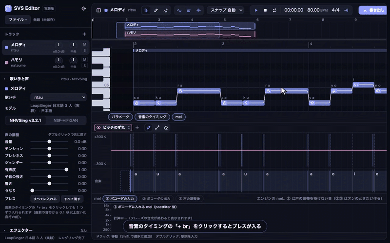
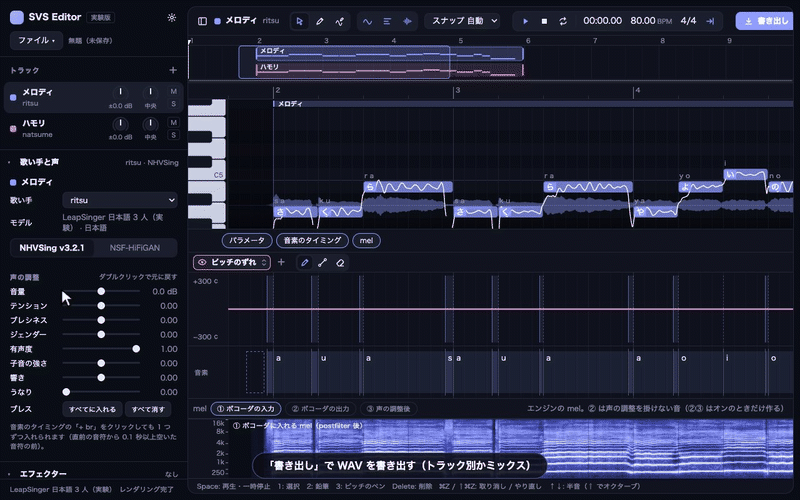

# VocaTab

[日本語](README.md)

Full-featured singing voice synthesis, in a browser tab.


A singing-voice-synthesis editor that runs entirely in the browser. The F0 model **PrettyPitch**, the acoustic
model **LeapSinger** and the vocoder **NHVSing** are all our own models and run fast on a CPU. The browser
version runs them with onnxruntime-web inside the page, so neither your score nor your audio ever leaves
your machine. The same UI can also be driven by a local Python engine (onnxruntime), which is faster still.

**Demo (GitHub Pages)**: https://wavtechyukky.github.io/vocatab/


## About this repository

- It exists to show how our singing-synthesis engine ([PrettyPitch](https://github.com/wavtechyukky/PrettyPitch), [LeapSinger](https://github.com/wavtechyukky/LeapSinger), [NHVSing](https://github.com/wavtechyukky/NHVSing)) is used. We do not currently plan to run it as a service or to add voicebanks. Feature requests and bug reports are welcome (please open an Issue).
- You are welcome to modify the models, the synthesis pipeline and the editor UI, or to use them as a reference for your own programs.
- The source code is MIT. The trained models and the voicebank are for non-commercial use only, and **the models themselves may not be redistributed** (see [License](#license)).

## Features

- Notes and lyrics in kana (さくら), romaji (sakura) or phoneme strings (`s a k u r a`, `sh`, `k a k i k u`)
- Pitch editing (pitch pen and parameter curves), vibrato and intonation depth per note and as curves
- AI retakes: re-draw the random numbers of the F0 model (pitch) or the acoustic model (voice) per note; step back to the previous or the first take
- Phoneme-boundary dragging; breaths made from each singer's real inhalations
- Voice adjustments: loudness, tension, breathiness, gender, voicing, consonant strength, resonance, growl (per track + curves)
- Effects: a "voice map" equalizer drawn over the voice's own spectrum, a compressor, and a reverb you shape directly
- Backing tracks (drop wav / mp3 / flac), MusicXML and UST import, WAV export (per track or mixdown)
- UI in Japanese, English, Chinese and Korean; accent colour and mel colour-map settings
- Autosave in the browser; project files (.svsproj, or .zip with the audio)

 
 

## Speed and memory

Measured on a MacBook Air (Apple silicon, 16 GB).

| | Rendering one 7.8 s phrase | Real-time factor | Notes |
|---|---|---|---|
| Browser (Chrome, 1 CPU thread) | about 3.3 s (F0 0.6 + acoustic 1.1 + vocoder 1.2) | about 0.4 | Safari about 3.5–4 s |
| Python (onnxruntime CPU, 4 threads) | about 0.8 s | about 0.1 | the first phrase takes +2 s to set up the vocoder |

- Both versions re-render only the phrases you edited (analysis and synthesis results are cached).
- Browser memory: about 470 MB after rendering. Caches are bounded by size, so repeated retakes do not grow it. After 3 minutes (default) without edits the engine is released (about 100–160 MB) and comes back in about 4 s on the next edit.
- Phrases longer than 30 s pass through as they are (the acoustic model's harmonic sum is folded into an ONNX `Loop`; a 30 s phrase peaks at +290 MB).
- Models (about 69 MB) are downloaded once and kept in the browser.

## How to use

### The screen

- **Sidebar**: tracks, singer and vocoder, voice adjustments, breaths, effects, rendering status. "File" (top left) has new / open / save / import score. The toolbar's leftmost button collapses the sidebar.
- **Piano roll**: notes and lyrics, the pitch line (white), the rendered waveform along the bottom. The toolbar holds select / pencil / pitch pen, snap, transport, tempo and meter, export.
- **Bottom panels** (tabs): parameters (draw curves), phoneme timing, mel. All of them scroll sideways with the trackpad and zoom with ⌘ + wheel.

### Notes and lyrics

1. With the pencil (key `2`) drag on the piano roll to place a note. With select (key `1`) move notes or drag their ends.
2. Double-click a note to type lyrics: kana, romaji, or space-separated phonemes. "ー" extends the previous vowel.
3. Click a note to open its popover: intonation and vibrato multipliers, and pitch / voice retakes.
4. Rendering starts automatically shortly after each edit ("Rendering 2/5 phrases" at the bottom left). Space plays.

### Pitch

- The pitch pen (key `3`) draws a pitch offset in cents on the piano roll; right-drag erases.
- The parameters panel has curves for pitch offset, intonation depth, vibrato depth and the voice adjustments, drawn with the pencil, line and eraser tools.
- The pitch line itself comes from the F0 model. If you do not like it, use "Retake" in the note popover.

### Breaths

- In the phoneme-timing panel, a dotted "+ br" appears before any note that starts 0.1 s or more after the previous one (and before the first note). Click it to add a breath; the sample is chosen per note and stays the same when you save.
- Click an existing breath to switch to another sample, right-click to remove it. The sidebar's "Breaths" buttons add to all or remove all.
- Breaths are mel spectrograms of the singer's real inhalations, resynthesised by the vocoder and mixed in after the voice. Only the loudness curve affects them.

### Voice adjustments and effects

- The sliders set track-wide values; the parameter curves are added on top. Double-click a slider to reset it.
- Effects (EQ, compressor, reverb) apply at playback and export without re-rendering. The EQ is drawn over the average spectrum of the rendered voice.

### Export and save

- "Export" (top right) writes WAV files, per track or as a mixdown, once rendering has finished.
- "File → Save" writes a `.svsproj` (score and settings, without backing audio); "Export with audio" writes a `.zip` that includes the backing tracks. Edits are also autosaved in the browser.

### Keyboard

`Space` play/pause　`1` select　`2` pencil　`3` pitch pen　`Delete` delete　`⌘Z` / `⇧⌘Z` undo / redo　`↑` `↓` semitone (`⇧` octave)　`⌘O` open　`⌘S` save　`⇧⌘S` save as

### Settings

The gear (top right): UI language, accent colour, mel colour map, and whether to compute on the GPU (WebGPU; off by default, experimental, Chrome only — not available in Safari).

## Running the browser version locally

```
python tools/build.py               # builds ui/dist/app.js (UI) and ui/dist/engine-worker.js (engine); needs node and npx
python -m http.server 8097          # serve this folder (any static server works)
```

Open `http://127.0.0.1:8097/ui/`. Query parameters: `?gpu=0` / `?gpu=1` forces the GPU off/on, `?idle=<sec>` changes the idle timeout.

## Python version

The same UI driven by a local Python engine (onnxruntime on the CPU). It is several times faster than the browser engine, and a good starting point if you want to plug in your own engine.

```
# PrettyPitch (score reading and F0 post-processing code) next to this folder
git clone https://github.com/wavtechyukky/PrettyPitch ../PrettyPitch
pip install -r requirements.txt     # numpy, onnxruntime, fastapi, uvicorn, pydantic, pyyaml, librosa, scipy, torch
python engine/server.py             # → http://127.0.0.1:8090/
```

Open `http://127.0.0.1:8090/` and the page uses the Python engine (`?engine=web` switches back to the in-browser one).
If PrettyPitch lives elsewhere, point to it with the `PRETTYPITCH_ROOT` environment variable or `code.prettypitch` in `voicebanks/*/voicebank.yaml`.

## How it works

```
score (notes, lyrics) → phoneme sequence → consonant-duration model (cons_dur) → phoneme durations
                                          → F0 model (PrettyPitch, 10 diffusion steps) → intonation + vibrato → pitch correction
final F0 (assembled in the UI) → acoustic model (LeapSinger, 1 step) → mel → vocoder (NHVSing) → harmonic + noise branches
                                          → voice adjustments → waveform + breaths → effects → playback / export
```

- The UI is TypeScript with no framework (Canvas2D and WebGL2). Everything around the models (score → phonemes, duration post-processing, F0 assembly, mel post-processing, the voice-adjustment DSP) was ported from the Python engine to TypeScript, and the tests in `ui/test/` check that it matches Python bit for bit. The models run on onnxruntime-web (WASM) inside a Web Worker.
- The acoustic model's harmonic excitation (a sum of 256 sines) is folded into one ONNX `Loop` in the exported graph: identical output, about 1/5 the peak memory, 10× faster session creation (`tools/acoustic_loop.py`; LeapSinger's `export/harmonic_loop.py`).
- Breaths: real inhalations were detected in each singer's recordings, auditioned and selected, and stored as float16 log-mel in the voicebank. At run time the vocoder's noise branch renders them (constant f0, all frames unvoiced) with a Tukey window at both ends. Since the bank holds mel features rather than recordings, it is treated like the models (`tools/breaths/`).
- Voice adjustments act on the vocoder's harmonic and noise branches and envelopes, so they take effect without re-rendering.

| Path | Role |
|---|---|
| `ui/src/` | the UI; `main.ts` wires it up, `render.ts` renders automatically, `breath.ts` places breaths |
| `ui/src/engine-web/` | the in-browser engine; `core.ts` analysis and synthesis, `worker.ts` the Web Worker, `client.ts` the UI-side client |
| `engine/` | the Python engine (`server.py` server, `pipeline.py` analysis and synthesis) |
| `voicebanks/`, `vocoders/` | models (ONNX) and configuration; `web.json` / `web_index.json` are written by `tools/export_web_assets.py` |
| `tools/` | build, asset export, ONNX Loop folding, breath-bank tools, verification tests |

## Voicebank

The bundled `leapsinger_ja_3singer` has three Japanese singers (Oniku Kurumi, Natsume Yuuri, Namine Ritsu). Contents and terms:
[voicebanks/leapsinger_ja_3singer/README.md](voicebanks/leapsinger_ja_3singer/README.md).

To add your own model, write `voicebanks/<name>/voicebank.yaml` (model files, singers, language, default vocoder) and run
`python tools/export_web_assets.py` to regenerate `web.json` and `web_index.json`. `publish: false` keeps a voicebank out of the browser list (Python only). Languages are added as PrettyPitch language packs (`dict/<lang>.yaml`); a Korean G2P lives in `ui/src/engine-web/g2p_ko.ts`.

## Development

```
npx -p typescript@5.6.3 tsc --noEmit -p ui/tsconfig.json      # type check
python tools/devtest/i18n_keys.py                             # translation keys
python tools/golden/dump_golden.py                            # render the test scores with the Python engine and dump every stage to ui/test/golden/
npx esbuild@0.25.0 ui/test/durations.test.ts --bundle --platform=node --format=esm --outfile=<tmp>/t.mjs && node <tmp>/t.mjs
                                                              # durations, f0, synth, breath (host code matches Python bit for bit)
python tools/run_e2e.py                                       # headless Chrome, score → waveform, compared with Python
```

The acoustic model's output differs slightly between onnxruntime-web and native onnxruntime (mel max 0.09, mean 0.0012, in ln units).

## Known limitations

- No full offline mode (Service Worker) and no multithreading (cross-origin isolation) yet; onnxruntime-web is loaded from jsDelivr.
- NSF-HiFiGAN is not bundled (13 s per phrase on the CPU; drop it into `vocoders/` and it works).
- Browsers: Chrome and Safari (checked on macOS 26). Phones are not targeted.
- Loop playback is not implemented.

## Acknowledgments

- Oniku Kurumi singing database — https://onikuru.info/db-download/
- Natsume Yuuri (database production: アマノケイ / voice provider: 霧野蒼太) — https://ksdcm1ng.wixsite.com/njksofficial/enunu-nnsvs
- Namine Ritsu singing database (recorded by Canon) — https://www.canon-voice.com/voicebanks/
- Neural Homomorphic Vocoder (Liu et al., Interspeech 2020) — https://www.isca-archive.org/interspeech_2020/liu20_interspeech.html
- hifisampler (the growl effect was ported from it) — Apache-2.0
- onnxruntime-web (Microsoft) — https://onnxruntime.ai/
- esbuild — https://esbuild.github.io/

## License

- **Source code**: MIT ([LICENSE](LICENSE)).
- **Trained models and voicebank** (`voicebanks/`, `vocoders/`, including the breath bank): personal, non-commercial use only. **The models themselves may not be redistributed.** Follow each singing database's terms and credit the singer when you publish output. For Natsume Yuuri the terms of use are bundled as `voicebanks/leapsinger_ja_3singer/夏目悠李_利用規約.txt`.
- Third-party code and material: [THIRD_PARTY_NOTICES.md](THIRD_PARTY_NOTICES.md).
