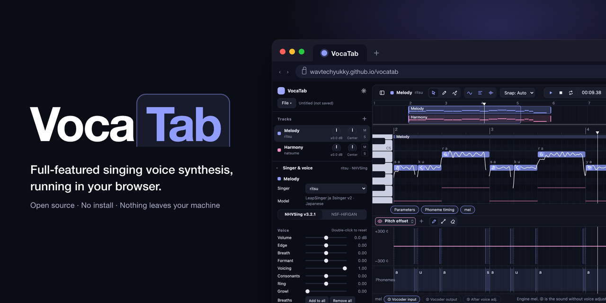
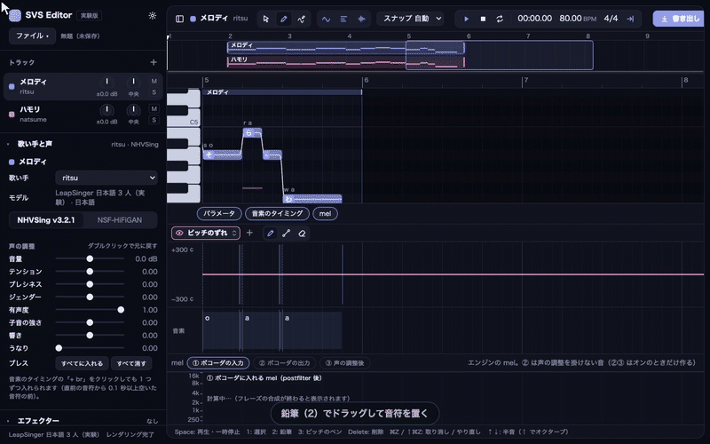
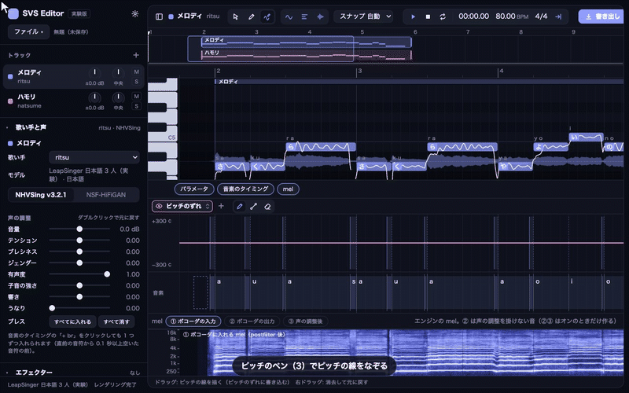
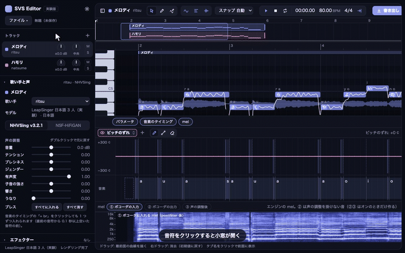

# VocaTab

[English](README.en.md)

歌声合成を、ブラウザのタブひとつで。



ブラウザだけで動く歌声合成エディタです。F0 モデル **PrettyPitch**・音響モデル **LeapSinger**・ボコーダ **NHVSing** は
いずれも自作のモデルで、CPU で高速に動きます。ブラウザ版は onnxruntime-web でモデルをブラウザの中で動かすので、
楽譜も音もサーバーに送りません。同じ画面を手元の Python（onnxruntime）で動かす Python 版もあり、そちらはさらに速く動きます。

**デモ（GitHub Pages）**: https://wavtechyukky.github.io/vocatab/



## このリポジトリについて

- 自作の歌声合成エンジン（[PrettyPitch](https://github.com/wavtechyukky/PrettyPitch)・[LeapSinger](https://github.com/wavtechyukky/LeapSinger)・[NHVSing](https://github.com/wavtechyukky/NHVSing)）の使い方を示すために作ったものです。継続的なサービスの提供や、ボイスバンクの追加は今のところ考えていません。機能の要望や不具合の報告は歓迎します（Issues へどうぞ）。
- モデル、歌声合成のパイプライン、エディタのインターフェースのどれも、改造したり、中身を参考にして自分のプログラムに取り入れたりすることを歓迎します。
- ソースコードは MIT です。学習済みモデルとボイスバンクは非商用でのみ利用でき、**モデル自体の再配布は禁止**です（[ライセンス](#ライセンス)）。

## できること

- 音符と歌詞: かな（「さくら」）、ローマ字（「sakura」）、音素の列（「s a k u r a」「sh」「k a k i k u」）のどれでも
- ピッチ線の編集（ピッチのペン・パラメータの曲線）、ビブラートと抑揚の強さ（音符ごと・曲線）
- AI リテイク: ピッチ（F0 モデル）と声（音響モデル）の乱数を音符ごとに引き直す。「一つ前」「最初」に戻せる
- 音素の境界の調整（ドラッグ）、ブレス（息継ぎ）の挿入（歌い手ごとに実際の息から作った素材）
- 声の調整: 音量・テンション・ブレシネス・ジェンダー・有声度・子音の強さ・響き・うなり（トラック全体 + 曲線）
- エフェクター: 声の地図のイコライザー（声のスペクトルの上に点を置く）・コンプレッサー・リバーブ（残響の形を直接さわる）
- 伴奏トラック（wav・mp3・flac をドロップ）、MusicXML / UST の読み込み（UST は連続音の歌詞や「息」も読む）、WAV の書き出し（トラック別・ミックス）
- 画面の言語: 日本語・英語・中国語・韓国語。アクセントカラーと mel の配色の設定
- 自動保存（ブラウザの中）、プロジェクトの保存（.svsproj / 音声も含めた .zip）

 

## 速さとメモリ

MacBook Air（M 系、16 GB）での実測。

| | 1 フレーズ（7.8 秒）のレンダリング | 実時間との比（RTF） | 備考 |
|---|---|---|---|
| ブラウザ版（Chrome、CPU 1 スレッド） | 約 3.3 秒（F0 0.6 + 音響 1.1 + ボコーダ 1.2） | 約 0.4 | Safari は約 3.5〜4 秒 |
| Python 版（onnxruntime CPU、4 スレッド） | 約 0.8 秒 | 約 0.1 | 最初の 1 フレーズだけボコーダの準備で +2 秒 |

- どちらも、編集したフレーズだけをレンダリングし直します（解析の結果と合成の結果は取り置く）。
- ブラウザ版のメモリ: レンダリング後のページで約 470 MB。取り置きはバイト数で区切るので、リテイクを続けても増えません。3 分（既定）操作が無いとエンジンを手放して約 100〜160 MB になり、次の編集で約 4 秒で戻ります。
- 30 秒を超える長いフレーズもそのまま通ります（音響モデルの倍音の計算を ONNX の `Loop` に畳んであり、30 秒のフレーズで +290 MB）。
- モデルは初回だけダウンロードし（約 69 MB）、ブラウザの中に取っておきます。

## 使い方

### 画面

- **左の帯**: トラックの一覧、歌い手とボコーダ、声の調整、ブレス、エフェクター、レンダリングの状況。左上の「ファイル」に新規・開く・保存・楽譜の読み込みがあります。帯はツールバー左端のボタンで畳めます。
- **ピアノロール**: 音符と歌詞、ピッチの線（白）、下端にレンダリングした波形。上のツールバーに 選択 / 鉛筆 / ピッチのペン、スナップ、再生、テンポと拍子、書き出し。
- **下のパネル**（タブで開け閉め）: パラメータ（曲線を描く）、音素のタイミング、mel。どれもトラックパッドで横に動き、⌘ + ホイールで横に拡大縮小できます。

### 音符と歌詞

1. 鉛筆（キー `2`）でピアノロールをドラッグして音符を置きます。選択（キー `1`）で動かしたり、端をドラッグして長さを変えたりします。
2. 音符をダブルクリックして歌詞を入れます。かな・ローマ字・空白で区切った音素のどれでも読みます。「ー」で前の母音を伸ばします。
3. 音符をクリックすると小窓が出て、その音符の抑揚とビブラートの倍率、ピッチと声のリテイクができます。
4. 編集すると少し待ってから自動でレンダリングされます（左下に「レンダリング中 2/5 フレーズ」のように出ます）。Space で再生。

### ピッチ

- ピアノロールのピッチのペン（キー `3`）で線を描くと、その分だけピッチがずれます（セント）。右ドラッグで消します。
- パラメータのパネルでは「ピッチのずれ」「抑揚の強さ」「ビブラートの強さ」などの曲線を鉛筆・直線・消しゴムで描けます。
- F0 の線そのものは F0 モデルが楽譜から作ります。気に入らなければ音符の小窓の「リテイク」で引き直します。

### ブレス

- 「音素のタイミング」のパネルで、直前の音符から 0.1 秒以上空いた音符（と曲の最初の音符）の前に「+ br」の点線が出ます。クリックで入ります（素材は音符ごとに決まり、保存しても変わりません）。
- 入れた所をもう一度クリックすると別の息に替わり、右クリックで消えます。左の帯の「ブレス」で全部に入れる・全部消すこともできます。
- ブレスは歌い手の実際の息継ぎから作った mel をボコーダで鳴らしたもので、声には混ざらず後から足します。効く調整は「音量」の曲線だけです。

### 声の調整とエフェクター

- 「声の調整」のつまみはトラック全体の値で、パラメータの曲線はそれに足されます。ダブルクリックで元に戻ります。
- エフェクター（EQ・コンプレッサー・リバーブ）は再生と書き出しのときに掛かり、レンダリングし直しません。EQ はレンダリングした声の平均のスペクトルの上に点を置いて調整します。

### 書き出しと保存

- 右上の「書き出し」を開き、「ミックスを書き出す」で全トラックをまとめた WAV を書き出します。トラックごとの WAV が欲しいときは「トラックを別々に書き出す」を開いてトラックを選びます。音は再生と同じ（ミュート・ソロ、トラックの音量とパン、エフェクターを反映）。レンダリングが済むまで待ちます。
- 「ファイル」→「保存」で `.svsproj`（楽譜と設定。伴奏の音声は含まない）、「音声も含めて書き出す」で伴奏も入れた `.zip` を作ります。編集はブラウザの中にも自動で保存されます。

### キー操作

`Space` 再生・一時停止　`1` 選択　`2` 鉛筆　`3` ピッチのペン　`Delete` 削除　`⌘Z` / `⇧⌘Z` 取り消し / やり直し　`↑` `↓` 半音（`⇧` でオクターブ）　`⌘O` 開く　`⌘S` 保存　`⇧⌘S` 名前を付けて保存

### 設定

右上の歯車: 画面の言語、アクセントカラー、mel の配色、GPU（WebGPU）で計算するか（既定はオフ。Chrome 向けの実験的なもので、Safari では使えません）。

## ブラウザ版を手元で動かす

```
python tools/build.py               # ui/dist/app.js（画面）と ui/dist/engine-worker.js（エンジン）を作る（node と npx が要る）
python -m http.server 8097          # このフォルダを配る（どの静的なサーバーでもよい）
```

`http://127.0.0.1:8097/ui/` を開きます。URL に `?gpu=0` / `?gpu=1` で GPU の有無、`?idle=<秒>` でエンジンを手放すまでの時間を変えられます。

## Python 版

同じ画面を、手元の Python のエンジン（onnxruntime の CPU）で動かします。ブラウザ版より数倍速く、自分のエンジンに差し替えるときの参考にもなります。

```
# PrettyPitch（楽譜の読み込みと F0 の後処理のコード）をこのフォルダの隣に置く
git clone https://github.com/wavtechyukky/PrettyPitch ../PrettyPitch
pip install -r requirements.txt     # numpy, onnxruntime, fastapi, uvicorn, pydantic, pyyaml, librosa, scipy, torch
python engine/server.py             # → http://127.0.0.1:8090/
```

ブラウザで `http://127.0.0.1:8090/` を開くだけで Python 版のエンジンが使われます（`?engine=web` を付けるとブラウザ版のエンジン）。
PrettyPitch を別の場所に置いたときは、環境変数 `PRETTYPITCH_ROOT` か `voicebanks/*/voicebank.yaml` の `code.prettypitch` で場所を指定します。

## 仕組み

```
楽譜（音符・歌詞） → 音素の列 → 子音の長さのモデル（cons_dur）→ 音素の長さ
                                   → F0 モデル（PrettyPitch、拡散 10 step）→ 抑揚の線とビブラート → ピッチ補正
最後の F0（画面で組み立て） → 音響モデル（LeapSinger、1 step）→ mel → ボコーダ（NHVSing）→ 調波・雑音の枝
                                   → 声の調整（テンション・ブレシネス・…）→ 波形 ＋ ブレス → エフェクター → 再生・書き出し
```

- 画面は TypeScript（フレームワーク無し、Canvas2D と WebGL2）。エンジンの前後の処理（楽譜 → 音素、長さの後処理、F0 の組み立て、mel の後処理、声の調整の信号処理）は Python 版から TypeScript に移植してあり、`ui/test/` の照らし合わせで Python とビット単位で一致することを確かめています。モデルは onnxruntime-web（WASM）で Web Worker の中で動きます。
- 音響モデルの励起の倍音（256 本の正弦波の足し合わせ）は、書き出した ONNX で 1 つの `Loop` に畳んであります。出力は同じで、ピークメモリが約 1/5、セッションの作成が 10 倍速くなります（`tools/acoustic_loop.py`、LeapSinger の `export/harmonic_loop.py`）。
- ブレスは、歌手ごとに実際の息継ぎを検出して聴いて選び、その ln-mel（float16）をボイスバンクに入れてあります。鳴らすときは f0 一定・全フレーム無声でボコーダの雑音の枝だけを通し、両端に Tukey 窓を掛けます。素材は録音そのものではなく mel なので、モデルと同じ扱いになります（`tools/breaths/`）。
- 声の調整はボコーダの調波・雑音の枝と包絡に掛けるので、レンダリングし直さずに効きます。

| 場所 | 役目 |
|---|---|
| `ui/src/` | 画面。`main.ts` が組み立て、`render.ts` が自動レンダリング、`breath.ts` がブレスの置き方 |
| `ui/src/engine-web/` | ブラウザ版のエンジン。`core.ts` が解析と合成、`worker.ts` が Web Worker、`client.ts` が画面側の窓口 |
| `engine/` | Python 版のエンジン（`server.py` がサーバー、`pipeline.py` が解析と合成） |
| `voicebanks/`・`vocoders/` | モデル（ONNX）と設定。`web.json`・`web_index.json` は `tools/export_web_assets.py` が書く |
| `tools/` | ビルド、設定の書き出し、ONNX の Loop 化、ブレスの素材作り、照らし合わせの試験 |

## ボイスバンク

同梱の `leapsinger_ja_3singer` は日本語 3 人（御丹宮くるみ・夏目悠李・波音リツ）です。中身と利用条件は
[voicebanks/leapsinger_ja_3singer/README.md](voicebanks/leapsinger_ja_3singer/README.md) を見てください。

自分のモデルを足すには `voicebanks/<名前>/voicebank.yaml` を書き（モデルのファイル・歌い手・言語・既定のボコーダ）、
`python tools/export_web_assets.py` で `web.json` と `web_index.json` を作り直します。`publish: false` を書くとブラウザ版の一覧には載せず、Python 版だけで使えます（ボコーダの `vocoder.yaml` も同じ）。言語は `dict/<lang>.yaml` の言語パック（PrettyPitch）で足せます（韓国語の G2P は `ui/src/engine-web/g2p_ko.ts` にあります）。

## 開発

```
npx -p typescript@5.6.3 tsc --noEmit -p ui/tsconfig.json      # 型検査
python tools/devtest/i18n_keys.py                             # 翻訳の鍵の過不足
python tools/golden/dump_golden.py                            # Python 版で試験用の楽譜を合成し、段ごとの値を ui/test/golden/ に書く
npx esbuild@0.25.0 ui/test/durations.test.ts --bundle --platform=node --format=esm --outfile=<作業用>/t.mjs && node <作業用>/t.mjs
                                                              # durations・f0・synth・breath・ust の 5 本（前後の処理は Python とビット単位で一致）
python tools/run_e2e.py                                       # ヘッドレス Chrome で楽譜から波形まで Python と比べる
```

音響モデルの出力は onnxruntime-web と手元の onnxruntime の計算の違いで少しずれます（mel で最大 0.09・平均 0.0012、ln の単位）。

## 既知の制限と今後

- 完全なオフライン動作（Service Worker）とマルチスレッド（cross-origin isolation）は未対応です。onnxruntime-web は jsDelivr から読みます。
- NSF-HiFiGAN は同梱していません（CPU では 1 フレーズに 13 秒かかるため。`vocoders/` に置けば動きます）。
- 対応ブラウザ: Chrome・Safari（macOS 26 で確認）。スマートフォンは想定していません。
- ループ再生は未実装です。

## 謝辞

歌声データベースと関連するプロジェクトに感謝します。

- 御丹宮くるみ歌声データベース（御丹宮くるみ） — https://onikuru.info/db-download/
- 夏目悠李（歌声DB制作: アマノケイ／音声提供者: 霧野蒼太） — https://ksdcm1ng.wixsite.com/njksofficial/enunu-nnsvs
- 「波音リツ」歌声データベース（波音リツ／音源収録: カノン） — https://www.canon-voice.com/voicebanks/
- Neural Homomorphic Vocoder（Liu et al., Interspeech 2020） — https://www.isca-archive.org/interspeech_2020/liu20_interspeech.html
- hifisampler（うなりの処理を移植しました） — Apache-2.0
- onnxruntime-web（Microsoft） — https://onnxruntime.ai/
- esbuild — https://esbuild.github.io/

## ライセンス

- **ソースコード**: MIT（[LICENSE](LICENSE)）。
- **学習済みモデルとボイスバンク**（`voicebanks/`・`vocoders/`。ブレスの素材を含む）: 個人・非商用でのみ利用できます。**モデル自体の再配布は禁止**です。各歌声データベースの利用規約に従い、出力を公開するときは歌い手のクレジットを表示してください。夏目悠李については `voicebanks/leapsinger_ja_3singer/夏目悠李_利用規約.txt` を同梱しています。
- 第三者のコードと素材の一覧は [THIRD_PARTY_NOTICES.md](THIRD_PARTY_NOTICES.md) にあります。
